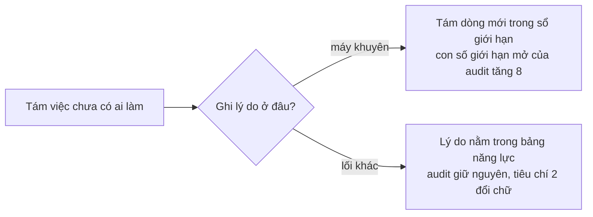
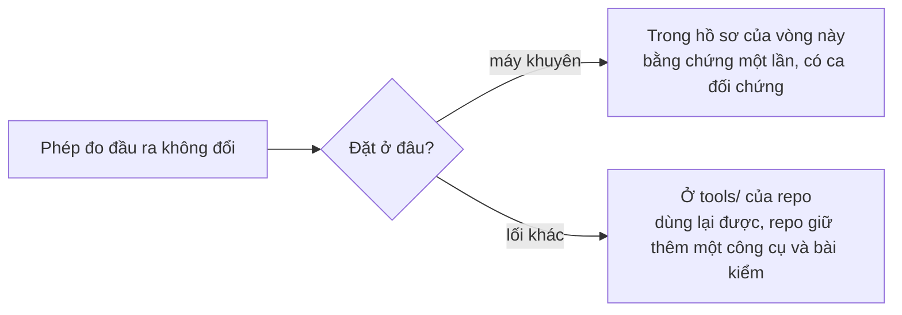

# Bảng năng lực, ổ cắm và phích — thiết kế cho mục 5.0

Máy viết ngày 2026-11-20, ở bước thiết kế (S1) của vòng `bang-nang-luc-o-cam` (bộ kit Delivery Loop, hàng 5.0 của
`docs/plan/lo-trinh.json`). Đầu vào: đề bài [0008](../../../wiki/specs/0008-capabilities-sockets-and-plugs.md), chủ repo
đã duyệt; ô cơ hội `_acceptance/bang-nang-luc-o-cam/opportunity.md`, chủ repo quyết «làm» ở Cổng Đáng. Bước này không
hỏi người: mỗi lựa chọn có căn cứ ghi ở `_acceptance/bang-nang-luc-o-cam/decisions.jsonl`; điều chỉ chủ repo quyết được
lên thẻ Cổng Phạm vi thành câu hỏi.

## Ý định

Đề bài 0008 chia Design Assembly thành ba tầng: lõi, ổ cắm, phích. Mục 5.0 biến danh mục hai mươi năng lực của đề bài
thành **dữ liệu máy đọc được**, đặt năm phép kiểm giữ nó, và cho `status` bày ra ổ nào đang có phích, ổ nào trống. Không
lệnh nào đang có được viết lại: các lệnh chỉ được khai là phích của ổ tương ứng.

**Mục tiêu.** Tám tiêu chí của đề bài, mỗi tiêu chí chứng bằng một lệnh.

**Không làm.** Cắm phích ngoài nào (thuộc 5.2 trở đi); viết lại lệnh nào; thêm sổ nào vào hợp đồng sổ; đo phích ngoài
theo bốn thước.

**Phản mục tiêu.** Bảng nói một điều mà mã làm điều khác (bảng trang trí). Phép kiểm chưa từng đỏ. Tên công cụ ngoài
lọt vào lõi qua chính bảng năng lực.

## Ràng buộc

- Script của plugin không gọi mô hình, không dùng mạng (đề bài 0008, «Ba tầng»).
- Tên bên thứ ba chỉ nằm trong thư mục phích cắm, như luật của bộ chuyển (quyết định 0031).
- `plugins/` viết tiếng Anh và không nêu tên repo hay sản phẩm nào của chủ repo.
- Đổi script hay khuôn của plugin thì theo luật phiên bản (`make plugin-version`).
- `status` vẫn vừa một màn: bài kiểm hiện có đòi tối đa 40 dòng.

## Các cách đã cân nhắc

1. **Một tệp bảng, phích ngoài mỗi phích một tệp trong thư mục riêng** (chọn). `references/capabilities.json` giữ hai
   mươi ổ cắm và các phích của chính plugin. Mỗi phích ngoài là một tệp `references/plugs/<id>.json` khai ổ nó cắm
   vào. Phích trỏ về ổ, ổ không nêu tên phích ngoài, nên bảng không bao giờ mang tên bên thứ ba.
2. **Một tệp duy nhất, phích ngoài nằm ngay trong bảng.** Gọn hơn, nhưng bảng thành một tệp lõi mang tên bên thứ ba,
   trái luật 5 của đề bài. Bỏ.
3. **Khai ổ cắm ngay trong từng script (một khối đầu tệp).** Mã và lời khai ở cùng chỗ. Nhưng năng lực chưa có phích
   sẽ không có tệp nào để khai, mà đó đúng là thứ phép kiểm «không lủng» phải thấy. Bỏ.

## Thiết kế

### Bảng năng lực — `plugins/design-assembly/references/capabilities.json`

Mỗi năng lực một mục: `id`, `stage` (sáu chặng của đề bài), `name`, `socket`, `plugs`, `layers`, `tiers`, và `limit`
khi chưa có phích mặc định.

- `socket.writes`: các sổ của hợp đồng (khoá của `LEDGERS` trong `templates/tools/design-assembly/contract.mjs`) mà
  chỉ ổ này được ghi.
- `socket.outputs`: tệp hay trang ổ giao ra.
- `socket.checks`: lệnh kiểm giữ ổ (đích `make` hay lệnh của plugin).
- `socket.decides`: `owner` hoặc `machine`.
- `socket.human` và `socket.machine`: hai mặt bàn giao của đề bài (mặt người bày gì, hỏi gì; mặt máy điều gì thành
  luật, lệnh nào giữ). Một mặt có thể vắng, nhưng phải có `reason`.
- `plugs`: phích của chính plugin; mỗi phích có `kind` (`command`, `gate`, `page`, `core`), `default`, và `scripts`
  là tệp nó chạy. Phích mặc định là phích chạy được khi chưa cài gì thêm.
- `routes`: các lệnh dẫn dắt (`new`, `adopt`) là lộ trình qua nhiều ổ, không phải phích (câu 2 của đề bài). Mỗi lộ
  trình nêu các ổ nó đi qua.

### Phích ngoài — `plugins/design-assembly/references/plugs/<id>.json`

Mỗi tệp: `id`, `socket` (id của năng lực), `names` (các tên phép «lõi sạch» tìm), `needs` (tài khoản, khoá, mạng; phích
cần chúng chỉ là phích phụ, thước 3 của đề bài), và tuỳ chọn `detect` (một tệp hay một gói mà khi có trong repo đích thì
phích ấy coi là đang cắm). Thư mục này và thư mục bộ chuyển là hai thư mục phích cắm.

### Năm phép kiểm — `plugins/design-assembly/scripts/capabilities.mjs`

Một mô-đun thuần, không đọc mạng, không gọi mô hình, trả danh sách vấn đề (rỗng là giữ được). Bài kiểm ở
`plugins/design-assembly/tests/test-capabilities.mjs`, chạy trong `make plugin-test`, tức trong `make check`. Mỗi phép kiểm
có một cặp: bảng thật thì xanh, một bản sao bị làm hỏng thì đỏ với thông điệp ghim.

1. **Bảng đủ hình** (tiêu chí 1): đúng hai mươi năng lực, mỗi ổ đủ bốn trường, mỗi phích chỉ tới script có thật.
2. **Không lủng** (tiêu chí 2): mỗi năng lực có một phích `default: true`, hoặc `limit` chỉ tới một dòng `open` của
   `references/limits.json`.
3. **Không trùng** (tiêu chí 3), hai nửa:
   - Không sổ nào nằm trong `writes` của hai ổ.
   - Mỗi script của plugin có lời gọi ghi (`writeFiles`, `writeFileSync`, `appendFileSync`) và nêu đường dẫn của một
     sổ (chuỗi đường dẫn, hay `LEDGERS.<khoá>`) thì sổ ấy phải thuộc một ổ mà script là phích, hoặc một ổ mà lộ trình
     của script đi qua. Đây là phép dò tĩnh; giới hạn của nó vào sổ giới hạn (một dòng mới).
4. **Lõi sạch** (tiêu chí 4): không tên nào trong `names` của các tệp phích ngoài xuất hiện trong lõi. Lõi là ba thư
   mục mà bài kiểm bộ chuyển đã gọi là lõi, cộng tệp bảng năng lực, cộng thư mục `skills/`. Tên khớp nguyên từ, không
   phân hoa thường, như `libraryNamesIn` của bộ chuyển.
5. **Tầng và bậc** (tiêu chí 5): mỗi `id` của `references/layers.json` và của `references/tiers.json` nằm trong
   `layers` hay `tiers` của ít nhất một năng lực.
6. **Hai mặt** (tiêu chí 8): mỗi ổ có `human` và `machine`; mặt nào vắng phải có `reason` khác rỗng.

### Bảng ổ cắm trong `status` (tiêu chí 6)

- `status --json` thêm đúng một khoá, `sockets`, đứng cuối: mỗi năng lực một mục (`id`, `name`, `plug`, `state`,
  `limit`, `outside`). `state` là `plugged` khi có phích mặc định, `empty` khi chỉ có dòng giới hạn. `outside` liệt các
  phích ngoài khai ổ ấy, mỗi phích kèm `here: true` khi `detect` của nó thấy trong repo đích.
- Bản cho người thêm hai dòng, vẫn vừa một màn: số ổ đã có phích trên tổng số, rồi tên các ổ trống kèm dòng giới hạn.
  Nếu repo đích có phích ngoài đang cắm thì thêm một dòng nêu chúng.
- Trang tài liệu (`status --out`) thêm một phần cho trọn bảng.

### Tám ổ trống

Đề bài đếm tám chỗ chưa có phích: tham chiếu, tài sản thương hiệu, nội dung, khuôn màn, đề bài dựng màn, báo cáo khả năng
truy cập, dùng chung giữa các repo, và phần nhìn của soát thiết kế. Mỗi chỗ một dòng mới ở `references/limits.json`
(loại `no-check`, kế hoạch `fix`), trừ chỗ nào đã có dòng mở nói đúng điều ấy thì trỏ vào dòng ấy.

**Điều chủ repo phải quyết** (lên thẻ Cổng Phạm vi): thêm dòng vào sổ giới hạn làm dòng «known limits: N open» của
`audit` tăng lên. Tiêu chí 7 nói đầu ra chỉ khác ở phần mới của `status`. Máy khuyên coi con số ấy là dữ liệu, không
phải hành vi; lối kia là để lý do của ổ trống trong chính bảng năng lực, khi ấy tiêu chí 2 phải đổi chữ.

**Điều thứ hai chủ repo quyết:** phép đo «đầu ra không đổi» đặt ở đâu.

### Hành vi không đổi (tiêu chí 7)

Hai cách đo:

1. Bộ bài kiểm của plugin xanh, sau khi chỉ sửa đúng các bài kiểm của `status` nói về khoá và dòng mới.
2. Một phép đo của riêng hồ sơ, `_acceptance/bang-nang-luc-o-cam/rang/same-outputs.sh`. Nó chạy `audit`, `inventory`,
   `find`, `decide --dry-run`, `upgrade --dry-run` và `status` trên repo này, ở gốc nhánh và ở HEAD, rồi so. Chỗ khác
   được chấp nhận chỉ gồm: khoá `sockets`, các dòng của bảng ổ cắm, và con số giới hạn mở của `audit`.

### Phiên bản

Plugin lên 0.19.0 (thêm, không phá), theo luật phiên bản của repo.

## Để lại cho bước dựng

Tên chính xác của các `id` phích ngoài; nội dung từng mặt người và mặt máy, lấy từ bảng của đề bài và trang bàn giao;
chia bài kiểm `status` thế nào cho gọn.
